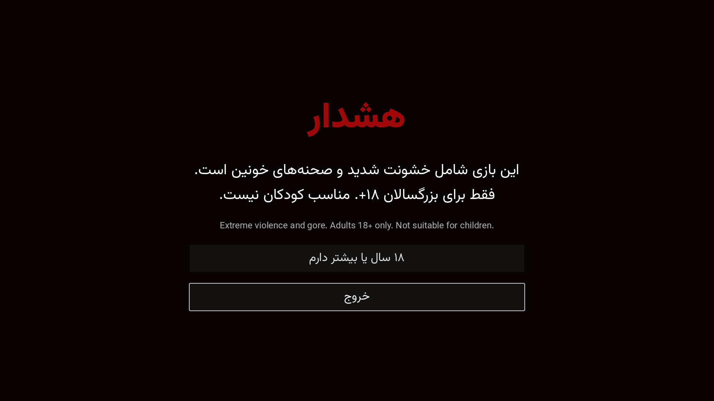
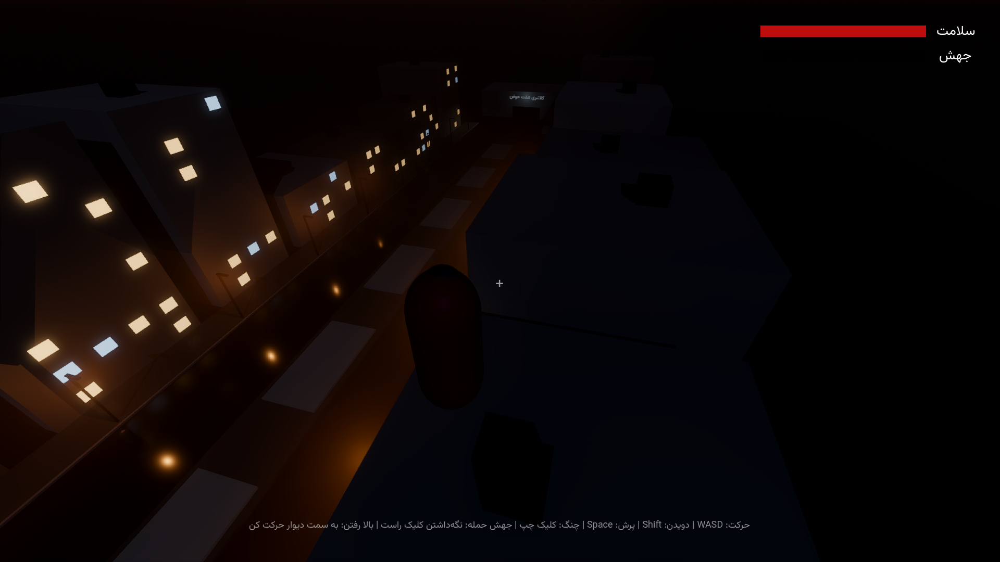
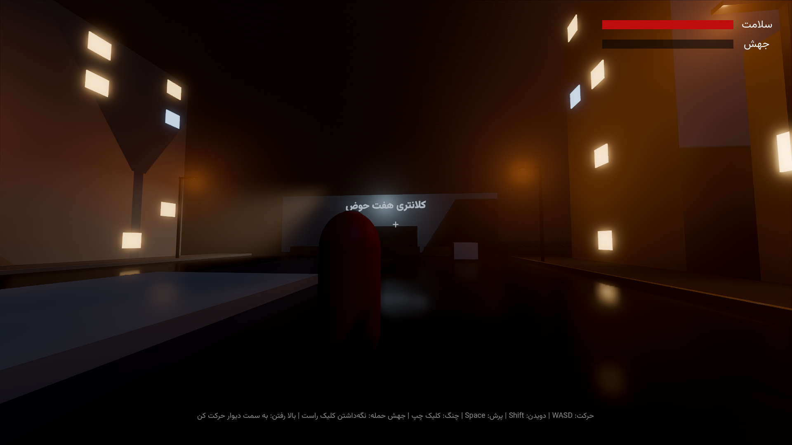

# Blood Hunter (شکارچی خون)

Brutal 18+ single-player action game. You are the last volatile in Tehran, hunting a traitor militia through the streets of Haft Hoz. Built in **Godot 4.7** (Forward+).

Design and per-engine build prompts live in [`prompts/`](prompts/README.md).

## Run

1. Install [Godot 4.7](https://godotengine.org/download) (standard build, not .NET).
2. Open `project.godot` and press F5.

Controls: WASD move, Shift sprint, Space jump, left click claw, hold right click to charge a pounce, move into a wall to climb, sprint along a wall in the air to wall-run, E to feed on a downed soldier, Esc to pause.

## Current state (vertical slice, steps 1-2 of the build order)

- 18+ age gate, main menu with graphics presets (Ultra, High, Medium, Low), Persian RTL UI with Vazirmatn.
- Ultra preset: SDFGI, SSR on wet asphalt, SSAO + SSIL, volumetric fog, 8K soft shadows, TAA + FSR 2. Godot has no hardware ray tracing; this is its highest real-time setting.
- The volatile: wall-climb with ledge mantle, wall-run, charged pounce takedown, claw, feeding (heals and fills the mutation meter; tendril, scream and rage unlock at 25, 50 and 100).
- Haft Hoz greybox: the seven pools, climbable apartment blocks, the militia-held کلانتری with a checkpoint.
- Placeholder militia that patrol, spot you and shoot.

## Tests

```
godot --headless --import
godot --headless -s res://tests/test_gameplay.gd
godot -s res://tests/screenshots.gd -- <output_dir>   # needs a GPU
```

## Screenshots (greybox)




