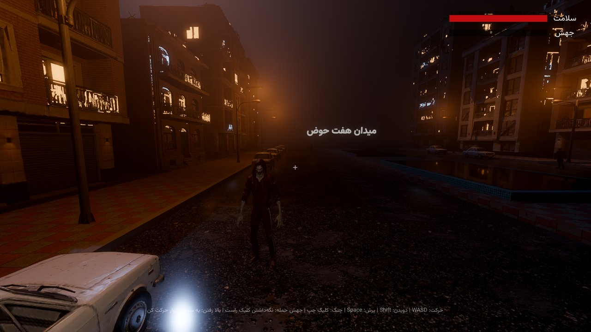
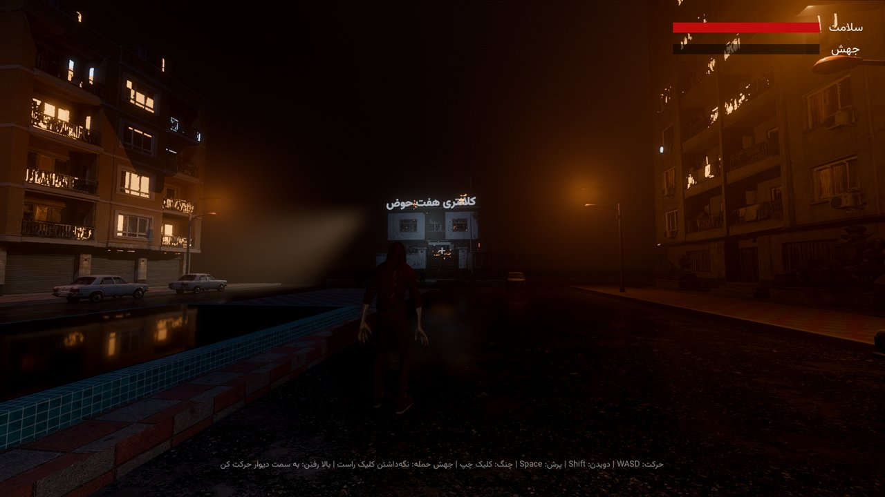
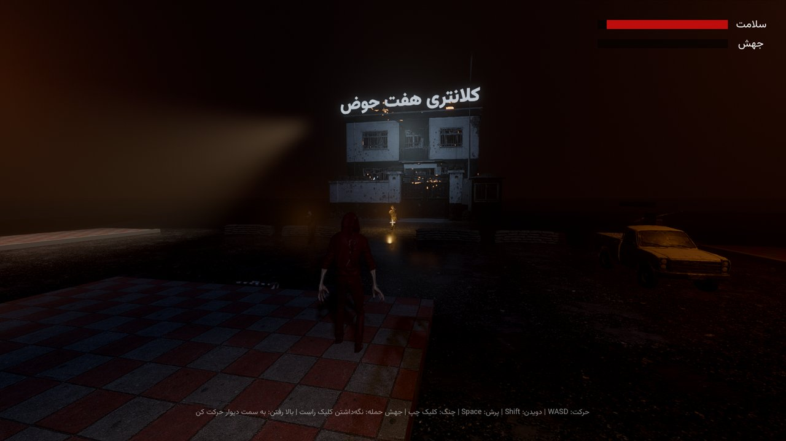
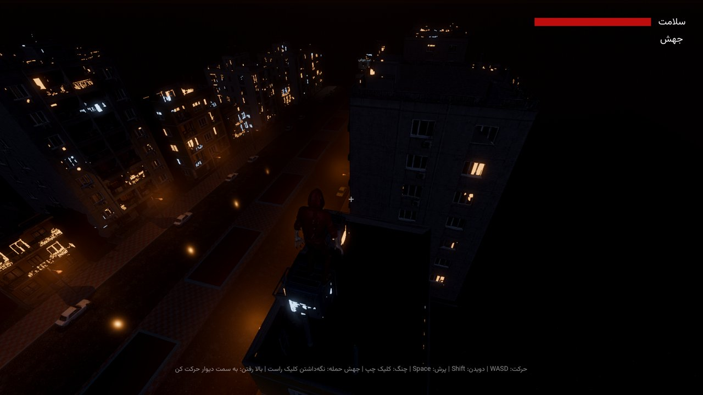

# Blood Hunter (شکارچی خون)

Brutal 18+ single-player action game. You are the last volatile in Tehran, hunting a traitor militia through the streets of Haft Hoz. Built in **Godot 4.7** (Forward+).

Design and per-engine build prompts live in [`prompts/`](prompts/README.md).

## Run

1. Install [Godot 4.7](https://godotengine.org/download) (standard build, not .NET).
2. Open `project.godot` and press F5.

Controls: WASD move, Shift sprint, Space jump, left click claw, hold right click to charge a pounce, move into a wall to climb, sprint along a wall in the air to wall-run, E to feed on a downed soldier, Esc to pause.

## Current state (vertical slice, steps 1-2 of the build order)

- 18+ age gate, main menu with graphics presets (Ultra, High, Medium, Low), Persian RTL UI with Vazirmatn.
- Ultra preset: SDFGI, SSR on wet asphalt, SSAO + SSIL, volumetric fog, 8K soft shadows, TAA + FSR 2. Godot has no hardware ray tracing; this is its highest real-time setting.
- The volatile: wall-climb with ledge mantle, wall-run, charged pounce takedown, claw, feeding (heals and fills the mutation meter; tendril, scream and rage unlock at 25, 50 and 100).
- Haft Hoz greybox: the seven pools, climbable apartment blocks, the militia-held کلانتری with a checkpoint.
- Placeholder militia that patrol, spot you and shoot.

## Real assets (Meshy: GPT Image 2.5 + image-to-3D + rigging + animation)

`tools/assets/generate.py` turns the JSON prompts in `tools/assets/manifest.json` into game assets, all through the Meshy API:

- **Characters** (volatile + 4 militia types): GPT Image 2.5 concept in A-pose, image-to-3D, auto-rig, then a preset animation set (volatile: idle, run, stalk, climb, wall-run, pounce, claw, scream, feed, death; militia: idle, patrol, combat, hit, down, death). Saved to `assets/characters/<id>/`.
- **Props** (armed Zamyad pickup, Paykan, sandbags, streetlight, rooftop tank and cooler, checkpoint barrier, tiled pool): concept, image-to-3D, saved to `assets/props/<id>/`.
- **Buildings** (four Tehran apartment blocks and the captured کلانتری): concept, image-to-3D with 2K textures, saved to `assets/buildings/<id>/` with a `windows.png` glass mask. At night `assets/shaders/spatial_env_window_glow.gdshader` lights a random share of the windows.
- **Textures** (brick, stone and concrete facades, wet asphalt, sidewalk, pool tiles, station wall): image only, then made seamless. Saved to `assets/textures/`.

Concept art goes to `tools/assets/concepts/`. Models are shrunk about 8x with `gltf-transform` (1K WebP textures) when it's installed. Finished Meshy task ids are cached in `tools/assets/state.json`, so re-runs never pay twice, and failed tasks (refunded by Meshy) are retried automatically. The game swaps each greybox for its generated asset when the file exists.

```
npm i -g @gltf-transform/cli      # optional, shrinks models
pip install numpy pillow          # optional, seamless textures
export MESHY_API_KEY=...
python3 tools/assets/generate.py --dry-run          # see every prompt
python3 tools/assets/generate.py --stage image      # concepts only, review before paying for 3D
python3 tools/assets/generate.py                    # everything still missing
python3 tools/assets/generate.py --only volatile --force   # redo one asset
```

Then open the project in Godot so it imports the new files.

## Tests

```
godot --headless --import
godot --headless -s res://tests/test_gameplay.gd
godot -s res://tests/screenshots.gd -- <output_dir>   # needs a GPU
```

## Screenshots






